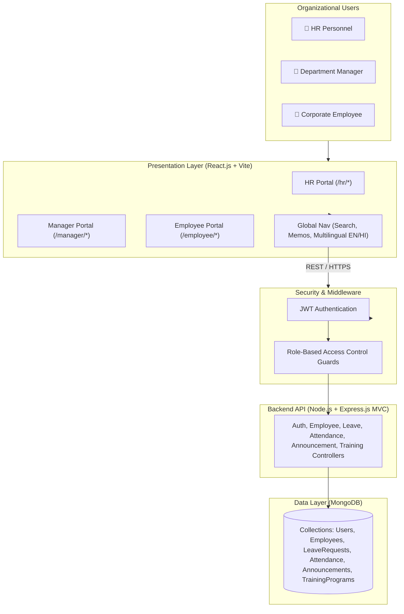
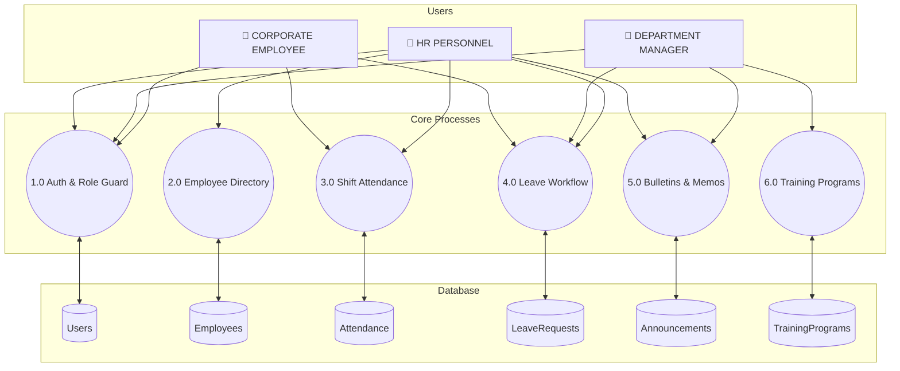

# StaffSync — Enterprise Project Documentation
**Modern Human Resource Management Solution (MERN Stack)**

---

## Table of Contents
1. [Ideation Phase](#1-ideation-phase)
   - [Brainstorm & Idea Prioritization](#brainstorm--idea-prioritization)
   - [Customer Problem Statements](#customer-problem-statements)
   - [Empathy Map Canvas](#empathy-map-canvas)
2. [Project Design Phase](#2-project-design-phase)
   - [Problem – Solution Fit](#problem--solution-fit)
   - [Proposed Solution Parameters](#proposed-solution-parameters)
   - [Solution Architecture](#solution-architecture)
3. [Project Planning Phase](#3-project-planning-phase)
   - [Product Backlog & Sprint Schedule](#product-backlog--sprint-schedule)
   - [Project Tracker & Sprint Velocity](#project-tracker--sprint-velocity)
4. [Project Design Phase-II](#4-project-design-phase-ii)
   - [Functional & Non-Functional Requirements](#functional--non-functional-requirements)
   - [Technical Architecture & Stack](#technical-architecture--stack)
   - [Data Flow Diagram (DFD Level 0 & 1)](#data-flow-diagram-dfd-level-0--1)
   - [User Stories & Acceptance Criteria](#user-stories--acceptance-criteria)
5. [User Acceptance Testing (UAT)](#5-user-acceptance-testing-uat)
   - [Testing Scope & Environment](#testing-scope--environment)
   - [Test Cases (Positive & Negative)](#test-cases)
   - [Bug Tracking & Sign-Off](#bug-tracking--sign-off)

---

## 1. Ideation Phase

### Brainstorm & Idea Prioritization
* **Core Problem Statement:** HR administrators, department managers, and enterprise employees struggle with disjointed, manual workforce management systems—such as scattered spreadsheets, paper-based leave approvals, and unverified attendance tracking—which leads to administrative delays, communication gaps, and payroll processing errors.
* **Brainstormed Ideas:**
  1. Role-based segregated authentication (HR, Manager, Employee) with JWT security.
  2. Real-time digital shift punch terminal (Clock In / Clock Out) with duration calculation.
  3. Automated leave management workflow with multi-level approval/rejection queues.
  4. Centralized employee directory with real-time CRUD operations.
  5. Cross-role internal messaging and corporate bulletin board.
  6. Departmental training and professional skill development tracking.
* **Idea Prioritization:**
  - *High Impact & High Feasibility:* Role-Based Access Control (RBAC), Employee Directory CRUD, Digital Leave Management.
  - *High Impact & Moderate Effort:* Real-Time Attendance Shift Punch Terminal, Cross-Role Announcements.
  - *Nice to Have:* Departmental Training Module, Bilingual Localization (English / Hindi).

### Customer Problem Statements
* **PS-1 (HR Personnel):** Trying to manage company-wide employee records and review leaves, but scattered spreadsheets cause delays and manual errors because there is no unified real-time platform, making HR feel overworked and stressed about payroll reconciliation.
* **PS-2 (Department Manager):** Trying to oversee team availability and approve leaves quickly, but requests get lost in email threads because supervisory tools are disconnected from employee logs, leaving managers hindered in planning project deadlines.
* **PS-3 (Corporate Employee):** Trying to clock in/out for shifts and apply for leaves digitally, but paper forms require awkward follow-ups because there is no transparent self-service portal, making employees anxious and disconnected.

### Empathy Map Canvas
* **Goal:** Establish a modern, centralized, role-based HRM solution that automates routine workflows, delivers real-time attendance tracking, and empowers employees with transparent self-service.
* **What they HEAR:** Management demanding accurate headcount summaries; employees asking if leaves are approved; payroll warning about spreadsheet math errors.
* **What they THINK and FEEL:** Pains over tedious data entry and unverified shifts; Gains from instant 1-click shift punching, transparent leave tracking, and centralized announcements.
* **What they SEE:** Stacks of paper forms, disconnected spreadsheets, and staff manually visiting HR desks to check balances.
* **What they SAY:** *"I need a single dashboard where I can view workforce attendance in real-time."*
* **What they DO:** Manually reconcile punch cards, send back-and-forth emails, and search cluttered inboxes.

---

## 2. Project Design Phase

### Problem – Solution Fit
* **Purpose:** Bridge operational gaps between HR, Managers, and Employees through a unified platform that manages the complete workforce lifecycle without multiple external tools.
* **Solution:** Full-stack MERN platform delivering role-segregated gateways, real-time shift punch terminals, automated leave workflows, and cross-departmental bulletins.

### Proposed Solution Parameters
* **Novelty:** Server-enforced role segregation (blocking role spoofing), instant digital shift terminal, bilingual localization (EN/HI), and experience-first mobile-app UI/UX.
* **Social Impact:** Alleviates administrative burnout, provides complete workplace transparency, and guarantees accurate shift records for payroll.
* **Business Model:** B2B SaaS per-employee subscription tier, modular add-ons for biometric device connectors, and enterprise support packages.
* **Scalability:** Stateless Express.js REST APIs and MongoDB clustering support horizontal scaling across growing enterprises.

### Solution Architecture

---

## 3. Project Planning Phase

### Product Backlog & Sprint Schedule
* **Sprint-1 (User Authentication & Access Governance):**
  - USN-1: Role-based secure registration and login (HR, Manager, Employee) [3 pts]
  - USN-2: Role-mismatch detection and access guard [2 pts]
  - USN-3: Password recovery and credential reset [2 pts]
* **Sprint-2 (Workforce Directory & Profile Hub):**
  - USN-4: Full employee directory CRUD management [3 pts]
  - USN-5: Employee profile view and custom avatar upload [2 pts]
  - USN-6: Department team roster filtering [2 pts]
* **Sprint-3 (Attendance Shift Punch & Leave Workflow):**
  - USN-7: Digital shift terminal (Clock In / Clock Out) with duration calculations [3 pts]
  - USN-8: Digital leave application submission [3 pts]
  - USN-9: Manager/HR leave approval and rejection queue [3 pts]
* **Sprint-4 (Corporate Comms & Skill Modules):**
  - USN-10: Cross-role corporate memo and bulletin broadcast [3 pts]
  - USN-11: Departmental training module creation and assignment [2 pts]
  - USN-12: Bilingual toggle (English / Hindi) with live server clock [2 pts]

### Project Tracker & Sprint Velocity
* Each sprint: 20 Story Points over 6 days. Total 80 Story Points completed on schedule.

---

## 4. Project Design Phase-II

### Functional & Non-Functional Requirements
* **FR-1:** Role-Based Authentication & Guarding
* **FR-2:** Workforce Directory CRUD Management
* **FR-3:** Attendance Shift Terminal & Daily Ledger
* **FR-4:** Leave Application & Multi-tier Approvals
* **FR-5:** Corporate Announcements & Bulletins
* **FR-6:** Departmental Training & Skill Growth
* **NFRs:** Usability (modern squircle aesthetic), Security (bcrypt + JWT), Reliability, Performance (<1.5s load), Availability (99.9% uptime), Scalability (clustered MongoDB).

### Technical Architecture & Stack
* **Frontend:** React.js 18, Vite, Context API, CSS3 with responsive squircle design.
* **Backend:** Node.js, Express.js with strict Model-View-Controller (MVC) pattern.
* **Database:** MongoDB with Mongoose object data modeling.
* **Security:** JSON Web Tokens (JWT), Bcrypt.js, CORS, HTTP-only cookie headers.

### Data Flow Diagram (DFD Level 0 & 1)

---

## 5. User Acceptance Testing (UAT)

### Testing Scope & Environment
* **URL:** `http://localhost:3000` *(Production: `https://staffsync.example.com`)*
* **Backend:** Node.js Express REST API on Port `5000` + MongoDB local/cloud cluster.
* **Test Accounts:**
  - HR: `hr@staffsync.com` / `password123`
  - Manager: `manager@staffsync.com` / `password123`
  - Employee: `employee@staffsync.com` / `password123`

### Test Cases Summary
| Test Case ID | Scenario | Result | Status |
| :--- | :--- | :--- | :---: |
| **TC-001** | User Authentication & Role Gateway Routing | Authenticated via JWT; routed to `/hr` dashboard | **PASS** |
| **TC-002** | Role-Based Access Restriction (Negative Test) | Employee blocked from HR portal with `403 Forbidden` | **PASS** |
| **TC-003** | Digital Attendance Shift Punch | Clock-in logged; duration calculated; status updated | **PASS** |
| **TC-004** | Submit Leave Request (Employee) | Request added to database with `pending` status | **PASS** |
| **TC-005** | Approve Leave Request (Manager / HR) | Status updated to `approved`; leave quota deducted | **PASS** |
| **TC-006** | Employee Directory CRUD (HR Admin) | New employee inserted; reflects across lists in real time | **PASS** |
| **TC-007** | Training Program Creation (Manager) | Module saved; appears in assigned employee dashboard | **PASS** |
| **TC-008** | Corporate Announcement Broadcast | Bulletin saved in MongoDB; notification sent to all users | **PASS** |

### Bug Tracking & Sign-Off
* **BG-001:** Empty leave reason allowed during submission -> *Fixed with mandatory validation.*
* **BG-002:** Avatar upload accepted non-image extensions -> *Fixed with file type and 2MB limit.*
* **BG-003:** End date selectable before Start date -> *Fixed with dynamic min-date constraint.*
* **Sign-off:** Approved by Project Lead and QA Tester Rohan on 26-05-2025.
